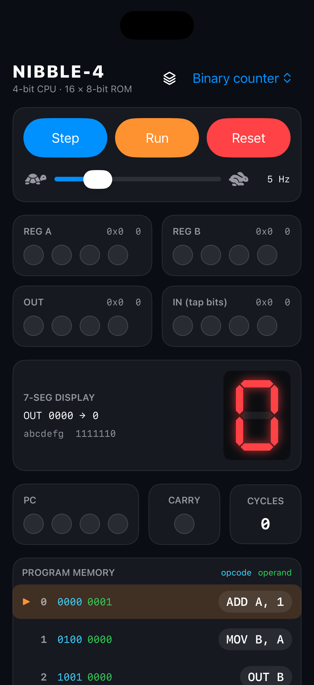

# NIBBLE-4

TD4 风格的 4 位 CPU 可视化模拟器。用 SwiftUI 写的多平台 App（iPhone、iPad、Mac、visionOS），把寄存器、进位、程序计数器和 ROM 画在同一屏上，单步或连续执行 8 位指令。



上图是内置程序 **Binary counter** 复位后的主界面。自上而下对应下面几块。

## 界面

| 区域 | 作用 |
| --- | --- |
| **NIBBLE-4** | 标题。右上角菜单切换内置程序，切换时会复位并装入对应 ROM。 |
| **Step / Run / Reset** | 单步、按当前频率连续执行（运行中按钮变为 Pause）、清零寄存器并停机。滑块调节时钟，范围 1–20 Hz。 |
| **REG A / REG B** | 两个 4 位通用寄存器。青色为 A，绿色为 B。旁边同时显示十六进制和十进制。 |
| **OUT** | 4 位输出端口，红色 LED。七段数码管直接由它驱动。 |
| **IN (tap bits)** | 4 位输入端口。点黄色 LED 翻转对应位，`IN A` / `IN B` 把这个值读进寄存器。 |
| **7-SEG DISPLAY** | 按 OUT 的低 4 位显示十六进制 0–F。左侧列出 `abcdefg` 段码，bit 0 是 a，bit 6 是 g。 |
| **PC / CARRY / CYCLES** | 4 位程序计数器、进位标志、已执行指令数。 |
| **PROGRAM MEMORY** | 16 × 8 位 ROM。青色是操作码，绿色是操作数。橙色箭头标出 PC 所在行；点右侧助记符可改操作码，带立即数的指令还可以改操作数。 |

截图里 PC 停在地址 0，当前指令是 `0000 0001`，即 `ADD A, 1`。后面两行是 `MOV B, A` 和 `OUT B`，再往下是 `JMP 0`，构成一个从 0 加到 15 再回绕的计数循环。

## 机器

每条指令 8 位：高 4 位是操作码，低 4 位是立即数。地址空间只有 16 字节，PC 加一后对 16 取模。

只有 `ADD A` 和 `ADD B` 会在和大于 15 时把进位置 1。其余指令执行后进位清 0。`JNC` 判断的是**上一条指令**留下的进位。未定义的操作码当作 NOP，只推进 PC 并清进位。

| 操作码 | 助记符 | 动作 |
| --- | --- | --- |
| `0000` | `ADD A, n` | `A ← A + n` |
| `0001` | `MOV A, B` | `A ← B` |
| `0010` | `IN A` | `A ← IN` |
| `0011` | `MOV A, n` | `A ← n` |
| `0100` | `MOV B, A` | `B ← A` |
| `0101` | `ADD B, n` | `B ← B + n` |
| `0110` | `IN B` | `B ← IN` |
| `0111` | `MOV B, n` | `B ← n` |
| `1001` | `OUT B` | `OUT ← B` |
| `1011` | `OUT n` | `OUT ← n` |
| `1110` | `JNC n` | 进位为 0 时 `PC ← n` |
| `1111` | `JMP n` | `PC ← n` |

## 内置程序

**Binary counter** — 每个周期把 A 加 1，经 B 送到 OUT，再跳回 0。数码管从 0 计到 F 后回绕。

```
ADD A, 1
MOV B, A
OUT B
JMP 0
```

**LED scanner** — 用立即数输出把单个亮点在 4 个 OUT 位上来回移动。

```
OUT 1
OUT 2
OUT 4
OUT 8
OUT 4
OUT 2
JMP 0
```

**Carry demo** — 反复给 A 加 5。没有进位就跳回开头；溢出后进位被置位，`JNC` 落空，数码管先亮 F 再亮 0，然后重新开始。

```
ADD A, 5
JNC 0
OUT 15
OUT 0
JMP 0
```

## 运行

用 Xcode 打开 `TD4BitCPU.xcodeproj`，选 iPhone、iPad、Mac 或 visionOS 模拟器（或真机），运行 target **TD4BitCPU**。入口是 `TD4BitCPUApp`，界面和 CPU 模型都在 `TD4BitCPU/CPUVisualizerView.swift`。
